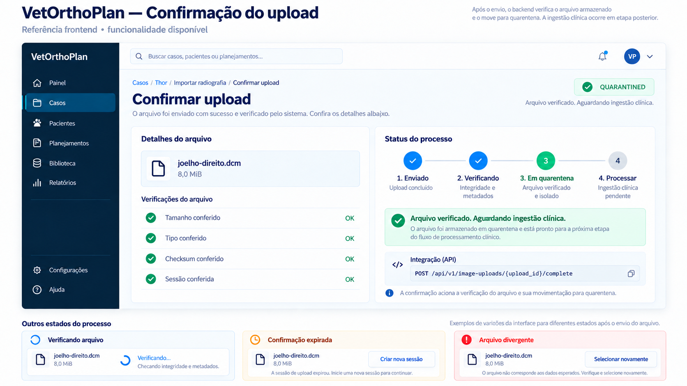

# Frontend — confirmar upload de radiografia

> Escopo: confirmação e agendamento do módulo Imaging (`IMG-01`).  
> Endpoint disponível: `POST /api/v1/image-uploads/{upload_id}/complete`.  
> Contrato publicado: OpenAPI `0.6.0`.  
> Referência visual: `docs/frontend/confirmacao-upload-v1.png`.



## 1. Objetivo

Depois que o browser conclui o `POST` direto ao object storage, o BFF confirma a sessão no backend. O backend consulta o objeto privado e só promove a sessão de `PENDING_UPLOAD` para `QUARANTINED` quando confere:

- tamanho exato;
- `Content-Type` declarado;
- checksum SHA-256 devolvido pelo storage;
- metadado `upload-id` da sessão;
- objeto não anterior à criação da sessão.

O endpoint é idempotente: confirmar novamente uma sessão já `QUARANTINED` não repete a inspeção e devolve o mesmo job de ingestão. `QUARANTINED` significa arquivo recebido e isolado; `QUEUED` significa que o processamento foi agendado. Nenhum deles significa `READY`, conteúdo clinicamente válido ou ingestão concluída.

## 2. Fluxo frontend

```text
POST direto ao storage concluído
        ↓
Navegador → BFF → POST /api/v1/image-uploads/{upload_id}/complete
        ↓
Backend executa HEAD privado no objeto e confere os metadados
        ↓
Persiste um único job QUEUED para o upload
        ↓
202 QUARANTINED → exibir “Aguardando ingestão clínica”
409              → tratar expiração, ausência ou divergência
404              → sessão indisponível no tenant ativo
```

Não há corpo na requisição. O `upload_id` devolvido pela criação da sessão é a única entrada funcional; tenant e ator continuam vindo da identidade autenticada.

## 3. Requisição

```http
POST /api/v1/image-uploads/00000000-0000-4000-8000-000000000124/complete
```

O frontend deve chamar a confirmação somente após receber sucesso do envio direto. Se a resposta do storage for ambígua por falha de rede, pode chamar a confirmação: objeto ausente produz erro recuperável e uma confirmação já concluída é idempotente.

## 4. Resposta `202 Accepted`

```json
{
  "upload_id": "00000000-0000-4000-8000-000000000124",
  "image_id": "00000000-0000-4000-8000-000000000125",
  "case_id": "00000000-0000-4000-8000-000000000064",
  "kind": "DICOM",
  "media_type": "application/dicom",
  "size_bytes": 8388608,
  "sha256": "0000000000000000000000000000000000000000000000000000000000000000",
  "status": "QUARANTINED",
  "completed_at": "2026-09-17T13:00:00Z",
  "job_id": "00000000-0000-4000-8000-000000000126",
  "job_status": "QUEUED"
}
```

O frontend deve manter os estados separados:

| Estado | Significado para a interface |
|---|---|
| `PENDING_UPLOAD` | Sessão criada; transporte ainda não confirmado |
| `QUARANTINED` | Objeto conferido e isolado; ingestão clínica ainda pendente |
| `PROCESSING` | Worker analisando checksum, formato e metadados básicos |
| `READY` | Conteúdo inicial aprovado; metadados disponíveis, viewer ainda pendente |
| `REJECTED` | Ingestão rejeitou o conteúdo com motivo seguro |

## 5. Erros

| HTTP/código | Motivo | Ação sugerida |
|---|---|---|
| `404 IMAGE_UPLOAD_NOT_FOUND` | Sessão ausente ou pertencente a outro tenant | Remover o estado local e voltar ao caso |
| `409 IMAGE_UPLOAD_EXPIRED` | Nenhum objeto foi encontrado após a expiração | Criar uma nova sessão e reenviar |
| `409 IMAGE_UPLOAD_OBJECT_INVALID` + `object_not_found` | Storage ainda não apresenta o objeto | Retry curto e limitado |
| `409 IMAGE_UPLOAD_OBJECT_INVALID` + `size_mismatch` | Tamanho divergente | Selecionar e enviar novamente |
| `409 IMAGE_UPLOAD_OBJECT_INVALID` + `media_type_mismatch` | Tipo divergente | Selecionar e enviar novamente |
| `409 IMAGE_UPLOAD_OBJECT_INVALID` + `checksum_mismatch` | Integridade divergente | Selecionar e enviar novamente |
| `409 IMAGE_UPLOAD_OBJECT_INVALID` + `upload_id_mismatch` | Metadado da sessão divergente | Descartar o fluxo local e criar nova sessão |
| `409 IMAGE_UPLOAD_OBJECT_INVALID` + `uploaded_before_session` | Objeto incompatível com a sessão | Criar nova sessão; não fazer retry cego |

Os motivos são seguros e não expõem bucket, chave do objeto, credenciais ou resposta bruta do provedor.

## 6. Critérios de aceite frontend

- chamar a confirmação pelo BFF, nunca anexando credenciais do storage;
- permitir retry da confirmação sem duplicar imagem ou sessão;
- guardar o `job_id` retornado para consultar o processamento;
- não recalcular nem substituir os valores devolvidos pelo backend;
- traduzir `QUARANTINED` como “Em quarentena” ou “Aguardando ingestão”, nunca “Pronto”;
- limpar da memória a URL e os campos pré-assinados após o transporte;
- não registrar URL, campos assinados, checksum ou pixels em telemetria;
- diferenciar visualmente expiração, objeto ainda ausente e divergência definitiva;
- manter o arquivo selecionado somente quando isso for seguro para uma nova tentativa explícita.

## 7. Limite do slice

A confirmação não lê os bytes da imagem. Ela publica o job numa fila durável no PostgreSQL; o worker do IMG-02 executa a inspeção posteriormente. Consulte [processamento e consulta de imagens](FRONTEND_PROCESSAMENTO_IMAGENS.md). Thumbnail, parsing clínico DICOM e viewer permanecem pendentes.
