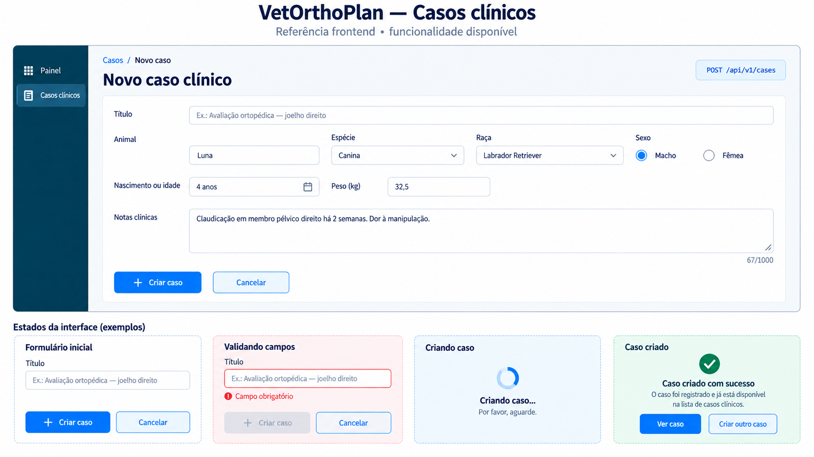

# Frontend — primeira funcionalidade: criar caso

> Escopo: primeiro vertical slice implementado no backend.  
> Endpoint: `POST /api/v1/cases`  
> Referência visual detalhada: `docs/frontend/criar-caso-v1.png`.



## 1. O que a imagem representa

A prancha detalhada cobre formulário, validação, envio e sucesso. A prancha geral do fluxo TPLO continua servindo como mapa da jornada futura.

Este documento cobre o cartão de criação do primeiro vertical slice. O backend também implementa agora as telas auxiliares de lista e detalhe, documentadas em [Frontend — listar e consultar casos clínicos](FRONTEND_LISTAR_CONSULTAR_CASOS.md).

```text
0. Autenticar + selecionar clínica   → dependência futura
1. Criar caso                        → IMPLEMENTADO
2. Importar radiografia              → PARCIAL: sessão de upload implementada
3. Validar + calibrar                → planejado
4. Medir                             → planejado
5. Simular TPLO                      → planejado
6. Posicionar implante               → planejado
7. Revisar + finalizar               → planejado
8. Relatório                         → planejado
```

O upload agora possui slices próprios para [criação da sessão pré-assinada](FRONTEND_CRIAR_SESSAO_UPLOAD.md) e [confirmação do objeto em quarentena](FRONTEND_CONFIRMAR_UPLOAD.md). Viewer, calibração, medições, implantes e relatório permanecem planejados.

## 2. Fluxo da tela implementada

```text
Usuário abre “Novo caso”
        ↓
Preenche e valida o formulário
        ↓
Frontend chama o BFF da mesma origem
        ↓
BFF encaminha POST /api/v1/cases
        ↓
201 Created → exibir caso criado em DRAFT
422         → exibir erros nos campos
falha rede  → manter formulário e permitir tentar novamente
```

Em desenvolvimento local, o endpoint pode ser chamado diretamente para validar o contrato. No fluxo integrado do produto, o navegador deve chamar o BFF; access token e refresh token não devem chegar ao JavaScript.

## 3. Contrato HTTP

### Requisição

`POST /api/v1/cases`  
`Content-Type: application/json`

```json
{
  "title": "Planejamento TPLO — joelho direito",
  "animal_name": "Paciente sintético 01",
  "species": "Canina",
  "breed": "Labrador Retriever",
  "sex": "FEMALE",
  "approximate_age_months": 72,
  "weight_kg": 31.4,
  "clinical_notes": "Fixture sintética para validação do fluxo."
}
```

Não enviar `tenant_id`, `created_by`, `status`, timestamps ou IDs pelo formulário. Esses valores pertencem ao contexto do backend e não podem ser escolhidos pelo usuário.

### Resposta de sucesso

Status: `201 Created`

```json
{
  "id": "00000000-0000-0000-0000-000000000003",
  "tenant_id": "00000000-0000-0000-0000-000000000001",
  "title": "Planejamento TPLO — joelho direito",
  "animal_name": "Paciente sintético 01",
  "species": "Canina",
  "breed": "Labrador Retriever",
  "sex": "FEMALE",
  "birth_date": null,
  "approximate_age_months": 72,
  "weight_kg": "31.40",
  "clinical_notes": "Fixture sintética para validação do fluxo.",
  "status": "DRAFT",
  "created_by": "00000000-0000-0000-0000-000000000002",
  "created_at": "2026-09-15T12:00:00Z",
  "updated_at": "2026-09-15T12:00:00Z"
}
```

O frontend deve usar `id` para navegar para a tela de detalhes, agora atendida por `GET /api/v1/cases/{case_id}`, e `status` para exibir o estado traduzido. `tenant_id` e `created_by` não precisam ser mostrados na interface.

### Erros

Status: `422 Unprocessable Entity`

```json
{
  "code": "REQUEST_VALIDATION_ERROR",
  "message": "A requisição contém campos inválidos.",
  "details": {
    "errors": [
      { "field": "title", "type": "string_too_short" }
    ]
  },
  "trace_id": null
}
```

Quando a regra for do domínio, o código será `CASE_VALIDATION_ERROR`. Para erro de rede ou servidor, preservar os valores preenchidos e permitir retry sem duplicar o envio.

## 4. Mapeamento da imagem para o formulário

| Elemento no cartão “1. Criar caso” | Implementação frontend | Campo/efeito HTTP |
|---|---|---|
| Título | input de texto | `title` |
| Animal | input de texto | `animal_name` |
| Espécie | select ou input controlado | `species` |
| Raça | select/input opcional | `breed` |
| Sexo | select opcional | `sex` |
| Nascimento ou idade | alternância entre data e meses | `birth_date` **ou** `approximate_age_months` |
| Peso | input numérico em kg | `weight_kg` |
| Notas | textarea | `clinical_notes` |
| Botão “Criar caso” | submit com estado de loading | chama `POST /api/v1/cases` |
| Badge “disponível” | indicador de integração | rota implementada |

## 5. Regras de validação da tela

- `title`, `animal_name` e `species`: obrigatórios;
- textos obrigatórios não podem ser vazios;
- `title`: até 200 caracteres;
- `animal_name`: até 120 caracteres;
- `species`: até 80 caracteres;
- `breed`: até 120 caracteres;
- `clinical_notes`: até 4.000 caracteres;
- `birth_date` não pode estar no futuro;
- enviar `birth_date` ou `approximate_age_months`, nunca os dois;
- idade aproximada: de 0 a 600 meses;
- peso: maior que zero, no máximo duas casas decimais e até 99.999,99 kg.

A validação no frontend melhora a experiência, mas não substitui a validação do backend. Os nomes dos campos devem permanecer em `snake_case` no contrato HTTP; a camada de formulário pode usar nomes amigáveis internamente.

## 6. Estados visuais mínimos

| Estado | Comportamento esperado |
|---|---|
| Inicial | Formulário vazio ou valores padrão, botão habilitado |
| Validação local | Mensagem junto ao campo, sem request |
| Enviando | Botão desabilitado contra duplo submit, indicador de progresso |
| Criado | Toast/feedback de sucesso e navegação usando o `id` retornado |
| Erro `422` | Mapear `details.errors[].field` para os campos |
| Erro de rede | Manter dados e oferecer “Tentar novamente” |
| Erro inesperado | Mensagem genérica; exibir `trace_id` apenas como referência de suporte |

## 7. Verificação manual local

Subir a aplicação conforme o [README](../README.md) e abrir o Swagger em <http://localhost:8000/docs>. A operação está agrupada em **Cases**.

Exemplo com `curl`:

```bash
curl -X POST http://localhost:8000/api/v1/cases \
  -H 'Content-Type: application/json' \
  -d '{
    "title": "Planejamento TPLO — joelho direito",
    "animal_name": "Paciente sintético 01",
    "species": "Canina",
    "approximate_age_months": 72,
    "weight_kg": 31.4
  }'
```

O ambiente local/teste utiliza um contexto de tenant e usuário temporário. A autenticação e a seleção de clínica serão conectadas posteriormente, após o fechamento do contrato AUTH-01 entre os projetos.

## 8. Referências técnicas

- [OpenAPI gerado](../openapi/openapi.json)
- [Rota FastAPI](../src/vetorthoplan/api/routes/cases.py)
- [Schemas HTTP](../src/vetorthoplan/api/schemas.py)
- [Caso de uso](../src/vetorthoplan/application/use_cases/create_case.py)
- [Listagem e consulta de casos](FRONTEND_LISTAR_CONSULTAR_CASOS.md)
- [Guia do fluxo completo](GUIA_FRONTEND_FLUXO_TPLO.md)
