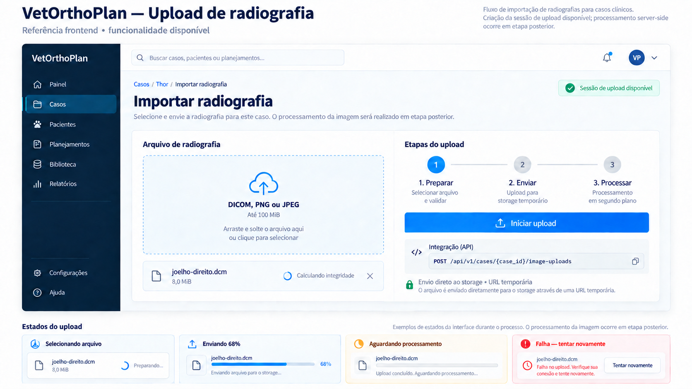

# Frontend — criar sessão de upload de radiografia

> Escopo: primeiro slice do módulo Imaging (`IMG-01`).
> Endpoint no código local: `POST /api/v1/cases/{case_id}/image-uploads`.
> Contrato local: OpenAPI `0.9.0`; `cecia.ufsj.edu.br` ainda publica `0.8.0`.

Envie `Idempotency-Key` em toda criação de sessão. Repetir a chave com os mesmos metadados recupera o mesmo `upload_id` e `image_id`; uma chave com outros metadados retorna `409 IMAGE_UPLOAD_IDEMPOTENCY_KEY_REUSED`. A sessão e a URL assinada mantêm a expiração original.
> Referência visual: `docs/frontend/upload-radiografia-v1.png`.



## 1. O que está disponível

O endpoint valida os metadados do arquivo, verifica se o caso pertence ao tenant ativo, cria uma sessão `PENDING_UPLOAD` em um prefixo privado de quarentena e devolve um formulário `POST` pré-assinado para envio direto ao object storage.

O endpoint de confirmação `POST /api/v1/image-uploads/{upload_id}/complete` também está disponível e promove um objeto conferido para `QUARANTINED`. O frontend deve separar transporte, confirmação e processamento e não apresentar a imagem como `READY` após o envio binário.

## 2. Fluxo frontend

```text
Selecionar DICOM, PNG ou JPEG (até 100 MiB)
        ↓
Calcular SHA-256 hexadecimal no cliente
        ↓
Navegador → BFF → POST /api/v1/cases/{case_id}/image-uploads
        ↓ 201
Montar multipart/form-data com todos os campos de upload.fields
        ↓
Acrescentar o arquivo e enviar POST diretamente para upload.url
        ↓
Transporte concluído → confirmar upload pelo BFF
        ↓
QUARANTINED → consultar job até `SUCCEEDED`, `REJECTED` ou `FAILED`
```

O BFF autentica a criação da sessão. O binário não deve atravessar simultaneamente o BFF e o backend clínico.

## 3. Requisição

```http
POST /api/v1/cases/00000000-0000-4000-8000-000000000064/image-uploads
Content-Type: application/json
```

```json
{
  "original_filename": "joelho-direito.dcm",
  "media_type": "application/dicom",
  "size_bytes": 8388608,
  "sha256": "0000000000000000000000000000000000000000000000000000000000000000"
}
```

Regras publicadas:

| Campo | Regra |
|---|---|
| `original_filename` | Nome simples, sem caminho; extensão `.dcm`, `.dicom`, `.png`, `.jpg` ou `.jpeg` coerente com o tipo |
| `media_type` | `application/dicom`, `image/dicom`, `image/png` ou `image/jpeg` |
| `size_bytes` | 1 a 104.857.600 bytes (100 MiB) |
| `sha256` | Digest hexadecimal de 64 caracteres, calculado antes de criar a sessão |

O limite inicial é de 20 sessões não expiradas por caso. A URL expira em cinco minutos por padrão.

A criação da sessão é idempotente por tenant, usuário e `Idempotency-Key`. Repetir a chave com o mesmo caso e os mesmos metadados devolve a sessão existente e uma nova assinatura limitada ao prazo de expiração original. A chave não expira enquanto o registro da sessão existir; após a limpeza do registro expirado, a chave pode ser reutilizada. Se a resposta `201` se perder, repita a requisição com a mesma chave. Uma sessão expirada exige uma chave nova. Depois do limite de sessões ativas, cancele uma sessão ainda pendente ou aguarde sua expiração; após reload, `GET /api/v1/cases/{case_id}/images` recupera os estados e o `job_id` associado.

O navegador precisa enviar o `POST multipart/form-data` à origem indicada por `upload.url`, incluindo todos os campos assinados e o arquivo por último. Não defina o header `Content-Type` manualmente e não siga redirecionamentos. A infraestrutura de cada ambiente deve permitir a origem exata do frontend e os métodos/headers necessários via CORS; os valores de origem e a resposta de sucesso são configurações do storage por ambiente.

## 4. Resposta `201 Created`

```json
{
  "upload_id": "00000000-0000-4000-8000-000000000124",
  "image_id": "00000000-0000-4000-8000-000000000125",
  "case_id": "00000000-0000-4000-8000-000000000064",
  "kind": "DICOM",
  "media_type": "application/dicom",
  "size_bytes": 8388608,
  "sha256": "0000000000000000000000000000000000000000000000000000000000000000",
  "status": "PENDING_UPLOAD",
  "upload": {
    "method": "POST",
    "url": "https://storage.example/...",
    "fields": {
      "key": "valor-assinado",
      "policy": "valor-assinado",
      "x-amz-signature": "valor-assinado"
    },
    "expires_at": "2026-09-17T12:05:00Z"
  }
}
```

`upload.fields` é opaco e pode variar conforme o provedor. Copie todos os pares para o `FormData`; não selecione campos manualmente nem persista a URL ou os campos assinados.

Exemplo de transporte no browser:

```ts
const body = new FormData()

for (const [name, value] of Object.entries(session.upload.fields)) {
  body.append(name, value)
}

body.append("file", file)

await fetch(session.upload.url, {
  method: session.upload.method,
  body,
})
```

Não defina `Content-Type` manualmente nesse `fetch`; o browser precisa incluir o boundary do `multipart/form-data`.

## 5. Estados e erros

| Situação | Comportamento esperado |
|---|---|
| Calculando checksum | Mostrar progresso/atividade e permitir cancelar antes da sessão |
| Criando sessão | Impedir duplo envio do mesmo comando |
| Enviando ao storage | Mostrar progresso de transporte separado do processamento |
| URL expirada | Criar nova sessão; nunca reutilizar assinatura expirada |
| `404 CASE_NOT_FOUND` | Voltar à lista ou informar que o caso não está disponível |
| `409 IMAGE_UPLOAD_LIMIT_EXCEEDED` | Informar o limite e evitar retry automático imediato |
| `422 REQUEST_VALIDATION_ERROR` | Associar erros estruturais aos campos |
| `422 IMAGE_UPLOAD_VALIDATION_ERROR` | Exibir a mensagem segura e manter o arquivo selecionado |
| Falha de rede/storage | Permitir nova tentativa consciente; não marcar como processado |

## 6. Segurança e critérios de aceite

- não registrar `upload.url`, `upload.fields`, pixels, JWT ou cookie em logs/telemetria;
- não enviar `tenant_id`, `actor_id` ou chave de storage no payload;
- calcular checksum fora da thread principal quando necessário para não congelar a interface;
- tratar a URL como credencial efêmera e mantê-la apenas em memória;
- configurar CORS do bucket apenas para as origens aprovadas;
- considerar sucesso do transporte diferente de sucesso da ingestão;
- usar somente arquivos sintéticos ou formalmente autorizados nos ambientes de desenvolvimento.

## 7. Continuação do fluxo

Após o transporte, siga o contrato [Frontend — confirmar upload de radiografia](FRONTEND_CONFIRMAR_UPLOAD.md). A confirmação agenda a ingestão e devolve `job_id`/`QUEUED`; o frontend pode então seguir o guia de [processamento e consulta de imagens](FRONTEND_PROCESSAMENTO_IMAGENS.md).
