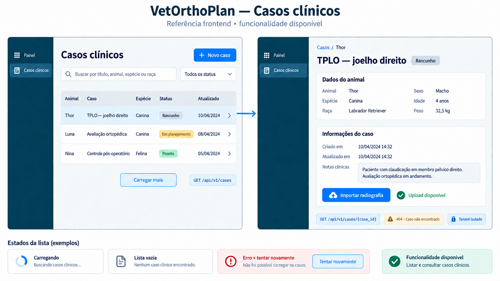

# Frontend — listar e consultar casos clínicos

> Escopo: segundo vertical slice do módulo de casos.  
> Endpoints: `GET /api/v1/cases` e `GET /api/v1/cases/{case_id}`.  
> Contrato local: OpenAPI `0.9.0`; `cecia.ufsj.edu.br` ainda publica `0.8.0`.



## 1. Objetivo

Este slice permite ao frontend recuperar os casos do tenant ativo, aplicar busca e filtro, navegar por cursor e abrir os detalhes de um caso. Ele complementa a criação já disponível em `POST /api/v1/cases`.

O detalhe do caso pode oferecer criação e confirmação do upload, documentadas nos guias de [criação da sessão](FRONTEND_CRIAR_SESSAO_UPLOAD.md) e [confirmação](FRONTEND_CONFIRMAR_UPLOAD.md). O processamento e a consulta de metadados também estão disponíveis; visualização de pixels e viewer permanecem pendentes.

O caso pode ser excluído permanentemente por `DELETE /api/v1/cases/{case_id}`. A API retorna 204 após remover os registros e objetos associados. Uploads ainda válidos ou jobs `QUEUED`/`PROCESSING` causam 409 `CASE_DELETE_NOT_ALLOWED`; leia `details.reason` (`ACTIVE_UPLOAD` ou `ACTIVE_INGESTION`) para orientar a pessoa usuária. Se a exclusão falhar por indisponibilidade do storage, mantenha o caso na interface e permita repetir a operação.

## 2. Fluxo frontend

```text
Abrir “Casos clínicos”
        ↓
GET /api/v1/cases?limit=20
        ↓
Renderizar loading, lista, vazio ou erro
        ↓
Buscar/filtrar → reiniciar cursor e carregar a primeira página
        ↓
Selecionar um item
        ↓
GET /api/v1/cases/{case_id}
        ↓
200 → exibir detalhes
404 → informar que o caso não está disponível
```

No produto integrado, o navegador chama Route Handlers do BFF na mesma origem. As rotas FastAPI documentadas aqui são o contrato entre o BFF e o backend clínico.

## 3. Listar casos

### Endpoint

```http
GET /api/v1/cases
```

### Parâmetros

| Parâmetro | Tipo | Padrão | Regra |
|---|---|---:|---|
| `limit` | inteiro | `20` | Entre 1 e 100 |
| `cursor` | string | — | Cursor opaco retornado pela página anterior |
| `status` | enum | — | `DRAFT`, `IN_PLANNING`, `READY` ou `ARCHIVED` |
| `search` | string | — | Até 200 caracteres; busca em título, animal, espécie e raça |

Exemplo:

```http
GET /api/v1/cases?limit=20&status=DRAFT&search=joelho
```

### Resposta

```json
{
  "items": [
    {
      "id": "00000000-0000-4000-8000-000000000064",
      "title": "TPLO — joelho direito",
      "animal_name": "Thor",
      "species": "Canina",
      "breed": "Labrador Retriever",
      "sex": "MALE",
      "status": "DRAFT",
      "created_at": "2026-09-15T12:00:00Z",
      "updated_at": "2026-09-15T12:00:00Z"
    }
  ],
  "next_cursor": "MjAyNi0wOS0xNVQxMjowMDowMCswMDowMHwwMDAwMDAwMC0wMDAwLTQwMDAtODAwMC0wMDAwMDAwMDAwNjQ",
  "status_counts": {
    "DRAFT": 12,
    "IN_PLANNING": 5,
    "READY": 8,
    "ARCHIVED": 2
  }
}
```

`next_cursor` será `null` quando não houver outra página. O frontend deve tratar o cursor como valor opaco: armazenar e reenviar sem interpretar ou modificar.

`status_counts` contém contagens de todo o tenant ativo, após aplicar `search`, mas ignora `status` e `cursor`. Valores zero são sempre incluídos. O total da aba “Todos” é a soma dos quatro valores.

O cursor é uma chave de continuação stateless baseada em data de criação e ID. Ele não expira nem representa um snapshot: casos criados depois da primeira página não aparecem na navegação em andamento; reinicie a consulta para atualizar. Caso malformado retorna `422 INVALID_CURSOR`. O contrato atual não permite editar o status do caso.

### Paginação e filtros

- ordenar conforme a resposta do backend; atualmente, casos mais recentes primeiro;
- ao mudar `status` ou `search`, descartar itens acumulados e reiniciar sem cursor;
- aplicar debounce à busca textual para evitar uma requisição por tecla;
- ao selecionar “Carregar mais”, preservar os filtros e enviar o último `next_cursor`;
- impedir requests duplicados durante o carregamento da próxima página;
- deduplicar itens por `id` ao acumular páginas.

## 4. Consultar detalhes

### Endpoint

```http
GET /api/v1/cases/{case_id}
```

Exemplo:

```http
GET /api/v1/cases/00000000-0000-4000-8000-000000000064
```

Status `200` devolve o contrato completo de `CaseResponse`, incluindo os dados clínicos do caso, `status`, autor e timestamps.

O frontend deve apresentar os campos clínicos necessários, mas não precisa exibir `tenant_id` nem `created_by`. Esses identificadores servem ao contexto e à auditoria.

### Caso não encontrado

```json
{
  "code": "CASE_NOT_FOUND",
  "message": "Caso clínico não encontrado.",
  "details": {
    "case_id": "00000000-0000-4000-8000-000000000064"
  },
  "trace_id": null
}
```

O backend responde `404` tanto para um ID inexistente quanto para um caso de outro tenant. A interface não deve tentar diferenciar essas situações.

## 5. Mapeamento da prancha

| Elemento visual | Contrato/comportamento |
|---|---|
| Campo de busca | parâmetro `search` com debounce |
| “Todos os status” | parâmetro `status`; opção geral omite o parâmetro |
| Linhas da tabela | elementos de `items` |
| Badge de estado | tradução visual de `status` sem mudar o valor da API |
| “Carregar mais” | usa `next_cursor`; ocultar/desabilitar quando for `null` |
| Clique na linha | navega usando `id` e consulta o detalhe |
| Tela de detalhes | resposta de `GET /api/v1/cases/{case_id}` |
| “Importar radiografia” | habilitado; inicia o contrato de criação da sessão de upload |

Tradução sugerida dos estados:

| API | Interface |
|---|---|
| `DRAFT` | Rascunho |
| `IN_PLANNING` | Em planejamento |
| `READY` | Pronto |
| `ARCHIVED` | Arquivado |

`READY` ainda não tem semântica de negócio ou transição definida no contrato. A interface pode usar o rótulo literal “Pronto”, mas não deve apresentá-lo como “Concluído” ou como conclusão clínica. A API atual não expõe transições de status.

## 6. Estados obrigatórios

### Lista

- carregamento inicial com skeleton;
- lista carregada;
- lista vazia;
- busca sem resultado;
- erro recuperável com “Tentar novamente”;
- carregamento da próxima página sem apagar a lista atual;
- fim da paginação.

### Detalhe

- carregando;
- carregado;
- `404` com retorno seguro à lista;
- identificador inválido (`422`);
- falha de rede com retry;
- caso arquivado em modo somente leitura quando essa política for implementada.

## 7. Isolamento e segurança

- não enviar `tenant_id` por query string ou header escolhido pelo browser;
- não filtrar tenant somente no frontend;
- não registrar dados clínicos completos no console;
- não exibir mensagem diferente para recurso de outro tenant;
- manter access token e refresh token apenas no BFF/cookies protegidos;
- usar somente dados sintéticos ou formalmente desidentificados em desenvolvimento.

O ambiente local continua usando tenant e ator fixos até a implementação do contrato AUTH-01. As queries do repositório já exigem o tenant ativo.

## 8. Verificação no Swagger

Com a API em execução, abrir <http://localhost:8000/docs> e localizar o grupo **Cases**.

Ordem recomendada para avaliação:

1. criar dois casos com `POST /api/v1/cases`;
2. listar com `GET /api/v1/cases`;
3. aplicar `status=DRAFT` e uma busca textual;
4. copiar um `id` e consultar `GET /api/v1/cases/{case_id}`;
5. testar um UUID inexistente e confirmar o `404` padronizado.

## 9. Referências técnicas

- [OpenAPI gerado](../openapi/openapi.json)
- [Rotas FastAPI](../src/vetorthoplan/api/routes/cases.py)
- [Schemas HTTP](../src/vetorthoplan/api/schemas.py)
- [Caso de uso de listagem](../src/vetorthoplan/application/use_cases/list_cases.py)
- [Caso de uso de consulta](../src/vetorthoplan/application/use_cases/get_case.py)
- [Contrato de criação de caso](FRONTEND_CRIAR_CASO_ENDPOINT.md)
- [Fluxo completo planejado](GUIA_FRONTEND_FLUXO_TPLO.md)
