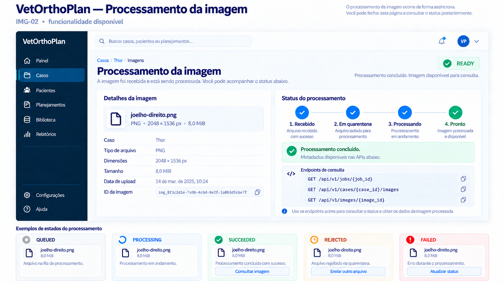

# Frontend — processamento e consulta de imagens

> Escopo: primeiro recorte do IMG-02.  
> Contrato publicado: OpenAPI `0.6.0`.  
> Identidade: adapter local temporário; JWT/RBAC permanecem fora deste incremento.



## Fluxo disponível

```text
POST /api/v1/image-uploads/{upload_id}/complete
        ↓ 202 + job_id
GET /api/v1/jobs/{job_id}
        ↓
QUEUED → PROCESSING → SUCCEEDED | REJECTED | FAILED
        ↓
GET /api/v1/cases/{case_id}/images
```

O worker lê o objeto em quarentena, recalcula o SHA-256, detecta o formato pelos bytes e extrai dimensões de PNG/JPEG. DICOM Part 10 é reconhecido pelo preâmbulo `DICM`; parsing de tags e pixels clínicos será acrescentado no próximo recorte.

## Consultar o job

```http
GET /api/v1/jobs/{job_id}
```

Resposta:

```json
{
  "id": "00000000-0000-4000-8000-000000000126",
  "case_id": "00000000-0000-4000-8000-000000000064",
  "image_id": "00000000-0000-4000-8000-000000000125",
  "upload_id": "00000000-0000-4000-8000-000000000124",
  "status": "SUCCEEDED",
  "attempts": 1,
  "error_code": null,
  "created_at": "2026-09-18T12:00:00Z",
  "updated_at": "2026-09-18T12:00:02Z",
  "started_at": "2026-09-18T12:00:01Z",
  "finished_at": "2026-09-18T12:00:02Z"
}
```

O frontend deve fazer polling somente enquanto o estado for `QUEUED` ou `PROCESSING`, com intervalo inicial de dois segundos. `SUCCEEDED`, `REJECTED` e `FAILED` são terminais neste contrato.

## Listar imagens do caso

```http
GET /api/v1/cases/{case_id}/images
```

```json
{
  "items": [
    {
      "id": "00000000-0000-4000-8000-000000000125",
      "upload_id": "00000000-0000-4000-8000-000000000124",
      "case_id": "00000000-0000-4000-8000-000000000064",
      "original_filename": "joelho-direito.png",
      "kind": "PNG",
      "media_type": "image/png",
      "detected_media_type": "image/png",
      "size_bytes": 8388608,
      "sha256": "0000000000000000000000000000000000000000000000000000000000000000",
      "status": "READY",
      "width_px": 2048,
      "height_px": 1536,
      "rejection_code": null,
      "created_at": "2026-09-18T12:00:00Z",
      "completed_at": "2026-09-18T12:00:01Z",
      "processed_at": "2026-09-18T12:00:02Z"
    }
  ]
}
```

Uma imagem individual pode ser consultada em `GET /api/v1/images/{image_id}` com o mesmo objeto de resposta.

## Estados de interface

| Estado da imagem | Apresentação |
|---|---|
| `PENDING_UPLOAD` | Envio ainda não confirmado |
| `QUARANTINED` | Arquivo recebido; aguardando worker |
| `PROCESSING` | Validando conteúdo |
| `READY` | Conteúdo aprovado; metadados disponíveis |
| `REJECTED` | Arquivo recusado; mostrar ação de reenviar |

Para `REJECTED`, o frontend pode traduzir `rejection_code`, mas deve manter uma mensagem genérica para códigos desconhecidos. Para `FAILED`, oferecer atualização manual; retry automático do backend ainda não faz parte deste recorte.

## Limites atuais

- a prévia PNG e a URL temporária estão disponíveis em `GET /api/v1/images/{image_id}/preview`;
- DICOM suporta inicialmente Explicit/Implicit VR Little Endian, monocromático e single-frame;
- transfer syntaxes comprimidas, RGB e multiframe ainda não são convertidas;
- não há antivírus;
- não há retry/backoff automático para falhas operacionais;
- migrations ainda precisam ser aplicadas no ambiente local/homologação.
