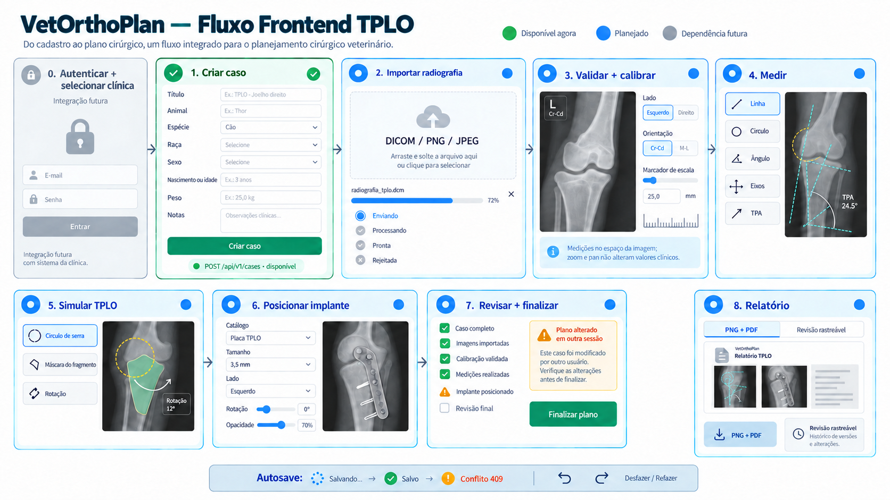

# Guia visual do fluxo frontend TPLO

> Status: referência funcional inicial para UX e desenvolvimento  
> Fonte: `PLANO_ARQUITETURAL_TPLO.md`  
> Escopo atual da API: casos, upload/ingestão, plano geométrico, calibração manual e medições geométricas
> Artefatos visuais: `docs/frontend/fluxo-frontend-tplo-v2.png`, `criar-caso-v1.png`, `casos-listagem-detalhe-v2.png`, `upload-radiografia-v1.png`, `confirmacao-upload-v1.png` e `processamento-imagem-v1.png`



## 1. Como utilizar esta referência

A prancha apresenta a jornada completa desejada para o MVP. Ela não é uma especificação visual definitiva nem deve ser reproduzida pixel a pixel. O frontend deve reutilizar o design system, o shell autenticado, o BFF, o cliente OpenAPI e os padrões de acessibilidade já existentes no projeto.

Há três níveis de maturidade no fluxo:

- **Disponível agora:** criar, listar e consultar casos; criar/confirmar upload; consultar/salvar plano geométrico; calcular escala manual e medições geométricas em imagens prontas.
- **Parcial:** transporte direto, confirmação, worker inicial e consulta de estado estão disponíveis; thumbnails, parsing clínico DICOM e viewer ainda não.
- **Parcial:** o backend persiste geometria, escala manual e resultados lineares/circulares/angulares. A interface clínica, revisão por parceiro e homologação das fórmulas anatômicas continuam pendentes.
- **Dependência futura:** autenticação e seleção da organização, que exigem o contrato AUTH-01 entre os projetos.

Enquanto AUTH-01 não estiver concluído, o frontend não deve inventar `tenant_id`, `created_by`, token ou seleção de organização. Esses valores não fazem parte do formulário de criação do caso.

## 2. Jornada principal

| Etapa | Tela/área | Resultado esperado | Situação da API |
|---:|---|---|---|
| 0 | Autenticação e clínica | Usuário entra com uma organização ativa assinada no token | Dependência futura |
| 1 | Novo caso | Caso criado no estado `DRAFT` | Disponível |
| 2 | Imagens do caso | DICOM, PNG ou JPEG enviado e processado | Parcial — sessão e confirmação disponíveis |
| 3 | Validação e calibração | Imagem, lado, orientação e escala confirmados | Parcial — plano e escala manual calculados pela API; validação clínica pendente |
| 4 | Medições | Linhas, círculos e ângulos registrados com geometria original e valores derivados | Parcial — API disponível; interface e homologação clínica pendentes |
| 5 | Simulação TPLO | Osteotomia, fragmento e rotação simulados | Planejado |
| 6 | Implantes | Placa/implante selecionado e posicionado | Planejado |
| 7 | Revisão e finalização | Checklist aprovado e revisão tornada imutável | Planejado |
| 8 | Relatório | PNG e PDF vinculados à revisão finalizada | Planejado |

As telas auxiliares de lista e detalhe de casos estão documentadas no [guia específico do segundo slice](FRONTEND_LISTAR_CONSULTAR_CASOS.md), com uma prancha própria para o desenvolvimento frontend.

## 3. Tela disponível: criar caso

### 3.1 Campos

| Campo de interface | Campo da API | Obrigatório | Regra atual |
|---|---|---:|---|
| Título | `title` | Sim | 1 a 200 caracteres |
| Animal | `animal_name` | Sim | 1 a 120 caracteres |
| Espécie | `species` | Sim | 1 a 80 caracteres |
| Raça | `breed` | Não | Até 120 caracteres |
| Sexo | `sex` | Não | `FEMALE`, `MALE` ou `UNKNOWN` |
| Data de nascimento | `birth_date` | Não | Não pode estar no futuro |
| Idade aproximada | `approximate_age_months` | Não | 0 a 600 meses |
| Peso | `weight_kg` | Não | Maior que zero, até duas casas decimais |
| Notas | `clinical_notes` | Não | Até 4.000 caracteres |

Data de nascimento e idade aproximada são alternativas. A interface deve impedir o preenchimento simultâneo ou explicar claramente qual opção prevalece. Valores vazios opcionais devem ser enviados como `null` ou omitidos, não como strings vazias.

### 3.2 Comportamento

1. Validar campos no cliente para resposta imediata, mantendo o backend como fonte final das regras.
2. Desabilitar apenas o envio duplicado enquanto a requisição estiver em andamento.
3. Manter os valores preenchidos quando ocorrer erro recuperável.
4. Exibir o erro próximo do campo quando `details` identificar um campo.
5. Após `201 Created`, usar o `id` devolvido para seguir à área do caso.
6. Mostrar o estado inicial `DRAFT` como rótulo traduzido, sem alterar o valor recebido da API.

### 3.3 Estados obrigatórios

- inicial;
- validação local;
- enviando;
- sucesso;
- erro de validação `422`;
- falha de rede com opção de tentar novamente;
- erro inesperado com referência de suporte quando houver `trace_id`.

O erro da API segue o formato:

```json
{
  "code": "REQUEST_VALIDATION_ERROR",
  "message": "A requisição contém campos inválidos.",
  "details": {
    "errors": [
      { "field": "title", "type": "string_too_short" }
    ]
  },
  "trace_id": null
}
```

## 4. Telas clínicas

### 4.1 Importar radiografia — sessão disponível

- aceitar DICOM, PNG e JPEG conforme o contrato OpenAPI `0.6.0`;
- apresentar progresso do transporte separado do processamento;
- representar `PENDING_UPLOAD`, `QUARANTINED`, `PROCESSING`, `READY` e `REJECTED`;
- permitir retry seguro sem criar duplicidades;
- não considerar o upload concluído enquanto a imagem não estiver `READY`;
- exibir rejeição com uma mensagem segura e acionável.

O envio binário usa o formulário pré-assinado: navegador → storage. Criação e confirmação passam pelo BFF; a confirmação agenda um job durável consumido pelo worker. O arquivo não deve ser encaminhado simultaneamente pelo processo Next.js e pelo backend clínico. Consulte os contratos de [criação](FRONTEND_CRIAR_SESSAO_UPLOAD.md), [confirmação](FRONTEND_CONFIRMAR_UPLOAD.md) e [processamento](FRONTEND_PROCESSAMENTO_IMAGENS.md), além das respectivas pranchas de [upload](frontend/upload-radiografia-v1.png), [quarentena](frontend/confirmacao-upload-v1.png) e [processamento](frontend/processamento-imagem-v1.png).

### 4.2 Validar e calibrar

- confirmar projeção, lado e orientação da radiografia;
- oferecer calibração por linha ou círculo;
- usar as pranchas conceituais de [calibração por linha](frontend/calibracao-linha-v1.svg) e [calibração por círculo](frontend/calibracao-circulo-v1.svg) como referência inicial de interface;
- solicitar o comprimento/diâmetro real em milímetros;
- diferenciar pixel spacing informativo de calibração clínica validada;
- bloquear medições em milímetros enquanto não houver calibração válida;
- avisar que alterar a calibração pode invalidar medidas dependentes.

### 4.3 Medir

- usar a referência visual conceitual de [medições anatômicas](frontend/medicoes-anatomicas-v1.svg);
- ferramentas iniciais: linha, círculo, ângulo, texto, eixos anatômico/mecânico e TPA;
- persistir pontos no espaço da imagem original, nunca em coordenadas CSS;
- apresentar medidas retornadas pelo backend e associar resultados em milímetros ao `calibration_id`; não calcular valores clínicos usando escala local do canvas;
- bloquear a criação de medidas em milímetros quando a resposta indicar `CALIBRATION_REQUIRED`; mostrar orientação para calibrar a imagem primeiro;
- diferenciar o ângulo em graus, que não depende da escala, das medidas lineares em milímetros;
- manter zoom, pan, rotação visual e window/level como estado de apresentação;
- oferecer seleção, edição, bloqueio, visibilidade e remoção de objetos;
- permitir operação equivalente por mouse, touch e teclado sempre que aplicável.

### 4.4 Simular TPLO

- usar a referência visual conceitual de [simulação geométrica da osteotomia](frontend/simulacao-osteotomia-tplo-v1.svg);
- posicionar círculo/lâmina e centro da osteotomia;
- confirmar raio manualmente e registrar o contorno fechado do fragmento proximal;
- enviar centro, raio, rotação e contorno no objeto `TPLO`; consumir a matriz afim e o `calibration_id` devolvidos pela API;
- mostrar a prévia rotacionada ao redor do centro da osteotomia, mantendo o contorno de origem editável;
- exibir TPA, ângulo de rotação, deslocamento de corda e medidas auxiliares apenas após validação clínica das fórmulas;
- preservar internamente a precisão e arredondar somente na apresentação.

### 4.5 Posicionar implante

- pesquisar família, variante, tamanho, lado e vista;
- exibir somente assets de catálogo aprovados e versionados;
- permitir posicionamento, rotação e ajuste de opacidade;
- manter escala em milímetros vinculada à calibração;
- salvar a versão exata do catálogo com a instância do implante.

### 4.6 Revisar e finalizar

Checklist mínimo proposto:

- caso completo;
- imagem em estado `READY`;
- orientação confirmada;
- calibração válida;
- referências e medições TPLO concluídas;
- osteotomia e rotação confirmadas;
- implante posicionado, quando obrigatório;
- observações revisadas.

Finalizar deve exigir confirmação explícita e produzir uma revisão imutável. Edições posteriores devem criar nova versão, sem sobrescrever relatório já emitido.

### 4.7 Relatório

- indicar claramente que a geração é assíncrona;
- representar aguardando, gerando, pronto e falhou;
- oferecer PNG e PDF apenas quando o job estiver concluído;
- mostrar número/hash da revisão, data e versão do catálogo;
- usar acesso temporário ao conteúdo, sem persistir URL pré-assinada no estado durável do browser.

## 5. Layout recomendado para o viewer

O viewer pode ser composto por quatro regiões, adaptáveis para desktop e tablet:

1. **Cabeçalho do caso:** animal, procedimento, status, revisão e estado do autosave.
2. **Barra de ferramentas:** navegação, calibração, medições, TPLO, fragmento e implantes.
3. **Canvas clínico:** Cornerstone3D e overlays vetoriais.
4. **Painel de propriedades:** valores, camadas, catálogo, checklist e histórico.

Em telas menores, o painel de propriedades pode virar drawer. O canvas não deve ser a única forma de acessar valores, excluir objetos ou entender erros; essas ações também precisam de controles semânticos acessíveis.

## 6. Estado, autosave e concorrência

- manter interações de alta frequência localmente;
- usar reducer/command model para o documento geométrico;
- oferecer desfazer/refazer local;
- realizar autosave com debounce e chave idempotente;
- exibir sempre `Salvando`, `Salvo`, `Erro ao salvar` ou `Conflito`;
- enviar a versão-base por `If-Match` ou mecanismo equivalente quando o contrato existir;
- em `409 PLAN_VERSION_CONFLICT`, interromper novos autosaves e oferecer recarregar ou duplicar;
- não fazer merge geométrico automático no MVP.

## 7. Integração prevista pelo BFF

O JavaScript do navegador não deve receber access token ou refresh token. As features chamam Route Handlers de mesma origem, e o BFF:

- resolve e renova a sessão;
- injeta o token server-side;
- valida origem/CSRF nas mutações;
- aplica timeout e normaliza erros;
- propaga IDs de requisição e rastreamento;
- usa o cliente TypeScript gerado pelo OpenAPI.

Recursos planejados para a jornada:

| Ação do frontend | Recurso da API |
|---|---|
| Criar caso | `POST /api/v1/cases` |
| Criar upload | `POST /api/v1/cases/{case_id}/image-uploads` |
| Confirmar upload | `POST /api/v1/image-uploads/{upload_id}/complete` |
| Criar plano | `POST /api/v1/cases/{case_id}/plans` |
| Carregar plano | `GET /api/v1/plans/{plan_id}` |
| Autosave | `PUT /api/v1/plans/{plan_id}/document` |
| Finalizar | `POST /api/v1/plans/{plan_id}/finalize` |
| Solicitar relatório | `POST /api/v1/plans/{plan_id}/reports` |
| Consultar processamento | `GET /api/v1/jobs/{job_id}` |

As rotas de criar caso, criar upload e confirmar upload estão implementadas. As demais são direção arquitetural e não devem ser codificadas no frontend antes da publicação dos respectivos contratos OpenAPI.

## 8. Critérios gerais de aceite do frontend

- nenhuma medida clínica muda ao aplicar zoom, pan ou redimensionar a janela;
- loading, vazio, erro, retry e sucesso são cobertos em cada etapa assíncrona;
- o fluxo principal pode ser concluído sem depender exclusivamente de cor;
- foco, atalhos, labels e mensagens são acessíveis;
- saída acidental com alterações não salvas é sinalizada;
- duas abas não sobrescrevem silenciosamente o mesmo plano;
- nenhuma credencial ou URL assinada é registrada em log;
- fixtures usam apenas dados sintéticos ou formalmente desidentificados;
- testes E2E cobrem criação de caso, upload/retry, calibração, autosave/conflito, finalização e relatório.

## 9. Limites desta prancha

- A imagem é uma referência de fluxo, não um diagnóstico ou protocolo cirúrgico.
- Fórmulas, tolerâncias e checklist clínico dependem de homologação veterinária.
- Cores, tipografia, espaçamento e componentes finais devem seguir o design system do frontend.
- A interface não deve copiar textos, marca, ativos ou composição visual de produtos de terceiros.
